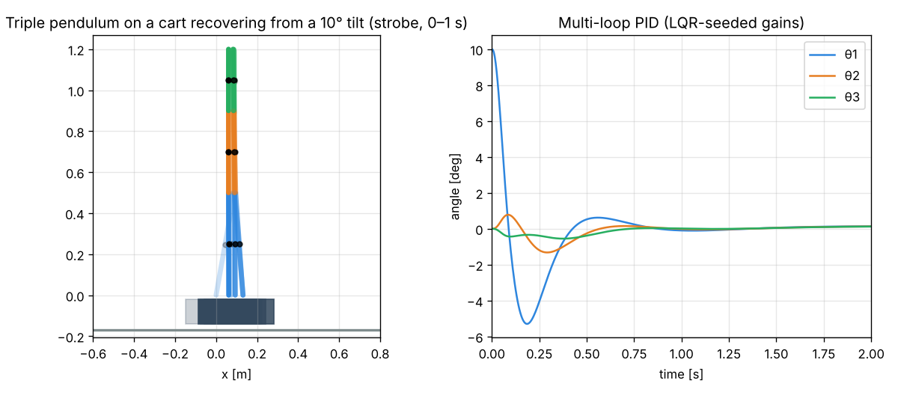
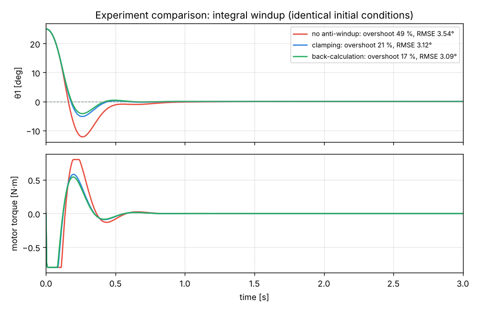

# redesigned-chainsaw — Interactive Inverted Pendulum Simulator

A desktop engineering tool for simulating, visualising and controlling **1-, 2- and 3-segment
inverted pendulums** on a moving cart or a motor-driven fixed pivot. It is built around a
mathematically exact multibody model, an interactive multi-loop PID controller and an
experiment mode for comparing controller tunings under identical conditions.



## Main features

- **Multibody physics** – exact Lagrangian equations of motion for 1–3 rigid segments
  (configurable length, mass, centre of mass, inertia, joint viscous + Coulomb friction),
  cart with friction and track end-stops, or fixed pivot; gravity; tip disturbances.
  Fixed-step RK4 integration decoupled from the GUI frame rate; validated against an
  independent Lagrangian derivation, analytic results and SciPy's adaptive solver.
- **Realistic actuator** – saturation, slew-rate limit, first-order lag and deadband.
- **Real-time visualisation** (QPainter) – segments, joints, pivot, centres of mass, angle arcs,
  angular-velocity arrows, upright-equilibrium ghost, trajectories, actuator/disturbance arrows,
  zoom / pan / fit / camera-follow and adjustable display settings.
- **Interactive PID** – Kp, Ki, Kd, per-component on/off, output limits, controller update
  rate (zero-order hold), anti-windup (clamping / back-calculation), integral limit, derivative
  from rate sensor or filtered difference, direct/reverse action, live P/I/D read-out.
  All settings apply while the simulation runs.
- **Multi-segment control** – one PID loop per segment angle plus a cart-position loop,
  summed into the single actuator command; gains can be seeded from an **LQR** design.
  See [docs/CONTROL.md](docs/CONTROL.md) for the principles and limitations.
- **Experiment & comparison mode** – deterministic runs from identical initial conditions,
  overlay plots (angle, error, control effort, cart position) and a metrics table
  (settling time, max deviation, overshoot, RMSE, control RMS/peak/energy). Save/load
  experiment sets, export CSV, load the gains of a stored run back into the controller.
- **Telemetry** – switchable live graphs of angles, angular velocities, control error,
  control signal (command / unsaturated / actuator), PID components, energy, cart position.
- **Simulation control** – start, pause, resume, reset, restart, single step, speed 0.05×–8×,
  tip pushes, 9 demonstration scenarios, JSON configuration save/load.



*Both figures are produced from real simulator runs by `scripts/make_figures.py`.*

## Supported operating systems

| OS | Status |
|---|---|
| macOS 12+ (Apple Silicon and Intel) | supported, tested in CI (`macos-latest`, Apple Silicon) |
| Windows 10 / 11 (x64) | supported, tested in CI (`windows-latest`) |
| Linux (x64) | works, tested in CI (`ubuntu-latest`) |

Python **3.10 – 3.13** (CI tests 3.10 and 3.12).

## Technology stack

Python · PySide6 (Qt 6 GUI) · NumPy (dynamics) · SciPy (LQR / Riccati, validation) ·
pyqtgraph (real-time graphs) · pytest (tests) · PyInstaller (optional standalone builds).

## Quick start

```bash
git clone https://github.com/aleksei-denisov/redesigned-chainsaw.git
cd redesigned-chainsaw
python3 -m venv .venv
source .venv/bin/activate          # Windows: .venv\Scripts\activate
python -m pip install -r requirements.txt
python main.py
```

Or use the one-step launchers: `./start.sh` (macOS/Linux) or `start.bat` (Windows).

## Documentation

- **[INSTALLATION.md](INSTALLATION.md)** – prerequisites, Python installation, virtual
  environments, macOS and Windows instructions, standalone builds, troubleshooting.
- **[RUNNING.md](RUNNING.md)** – launching, simulation controls, configuring the pendulum,
  tuning the PID, running and comparing experiments, configuration files, tests.
- [docs/PHYSICS.md](docs/PHYSICS.md) – the multibody model and its validation.
- [docs/CONTROL.md](docs/CONTROL.md) – controller structure, multi-segment strategy, limitations.
- [docs/DEVELOPMENT.md](docs/DEVELOPMENT.md) – architecture, tests, CI, extending the project.
- [CLAUDE.md](CLAUDE.md) – working rules for contributors and AI assistants.

## Project layout

```
main.py                    entry point (python main.py)
pendulum_sim/
  physics/                 multibody model, actuator, RK4 (no GUI code)
  control/                 PID loop, multi-loop controller, LQR seeding
  simulation/              config/JSON, fixed-step engine, telemetry, experiments, metrics, scenarios
  ui/                      PySide6 window, QPainter view, panels, pyqtgraph plots
configs/                   example configurations (one per built-in scenario)
scripts/                   export_examples.py, build_app.py, make_figures.py
tests/                     physics, controller, simulation and offscreen GUI tests
docs/                      technical documentation and figures
start.sh / start.bat       one-step launchers
```
