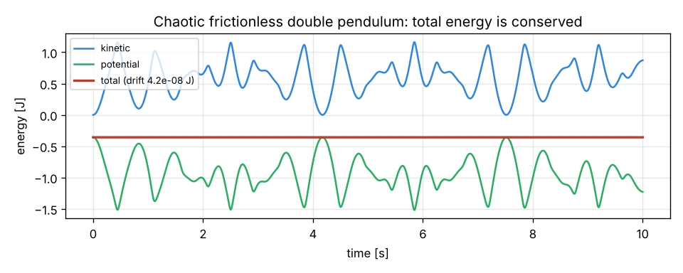

# Physical model

Implementation: [`pendulum_sim/physics/model.py`](../pendulum_sim/physics/model.py).

## Coordinates and conventions

- Generalised coordinates `q = [x, θ1, …, θn]`, `n ∈ {1, 2, 3}`.
- `x` is the cart position [m] (identically 0 for a fixed pivot).
- `θi` is the **absolute** angle of segment *i* from the **upward** vertical; positive when the
  segment leans towards +x (clockwise on screen). `θ = 0` is the (unstable) upright equilibrium,
  `θ = 180°` the stable hanging one.
- State `s = [q, q̇]`, size `2(n+1)`.

Each segment *i* has length `Li`, mass `mi`, centre-of-mass distance `ci = com_ratio·Li` from its
lower joint and inertia `Ii` about its centre of mass.

## Kinematics

With the lever coefficients `a_ij = Lj (j < i)`, `a_ii = ci`, `a_ij = 0 (j > i)`:

```
x_ci = x + Σj a_ij sin θj        y_ci = Σj a_ij cos θj
```

## Equations of motion

Kinetic energy `T = ½ q̇ᵀ M(q) q̇` with the constant matrices `W = Aᵀ diag(m) A`, `h = Aᵀ m`:

```
M_xx   = m_cart + Σ mi
M_xθj  = hj cos θj
M_θjθk = Wjk cos(θj − θk) + δjk Ij
```

Potential energy `V = g Σj hj cos θj`. The Euler–Lagrange equations give

```
M(q) q̈ + C(q, q̇) = G(q) + Q
C_x  = −Σk hk sin θk θ̇k²
C_θj =  Σk Wjk sin(θj − θk) θ̇k²
G_θj =  g hj sin θj
```

Generalised forces `Q`:

| Effect | Contribution |
|---|---|
| Cart actuator force F | `Q_x += F` |
| Base motor torque τ (fixed pivot) | `Q_θ1 += τ` |
| Cart viscous friction | `Q_x −= b_x ẋ` |
| Joint *k* friction on relative velocity `φ̇k = θ̇k − θ̇k−1` | `τk = −bk φ̇k − τc,k tanh(φ̇k/ε)`, applied `+τk` to segment *k* and `−τk` to segment *k−1* |
| Track end stops | stiff spring–damper beyond `±track_length/2` |
| Horizontal tip force F_d | `Q = Jᵀ F_d`: `Q_x += F_d`, `Q_θj += F_d Lj cos θj` |

`ε = 0.02 rad/s` smooths the Coulomb friction so the fixed-step integrator stays well behaved.

For a fixed pivot the `x` row and column are removed (`ẍ = 0`).

## Actuator

Command → deadband → saturation → first-order lag (exact discretisation) → slew-rate limit →
output, held constant during each physics step.

## Integration

Classical fixed-step **RK4**, default `dt = 1 ms` (adjustable 0.01–10 ms). A fixed step keeps runs
bit-for-bit reproducible (essential for the experiment comparison) and decouples physics from
the GUI frame rate. The engine raises `SimulationDiverged` if the state becomes non-finite or
unphysically large.

## Validation (tests/test_physics.py)

- Accelerations agree with an **independent Lagrangian** built only from body kinematics using
  finite differences (1–3 segments, cart and fixed base, random states).
- Kinetic energy agrees with `Σ ½ m v² + ½ I ω²` from numerically differentiated positions.
- Single cart-pole matches the textbook closed-form equations to machine precision.
- Small-oscillation period of the hanging compound pendulum matches `2π √((I + m c²)/(m g c))`.
- Energy is conserved without friction (drift < 10⁻⁵ of `m g`·1 m over 1.5 s, all
  configurations); friction dissipates energy monotonically.
- Horizontal momentum is conserved on a free cart.
- RK4 agrees with SciPy `solve_ivp` (rtol 10⁻¹⁰) and shows 4th-order convergence.
- The tip-force generalised force matches the virtual-work definition.


